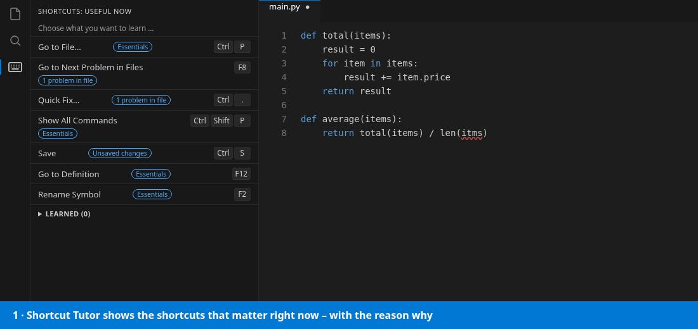
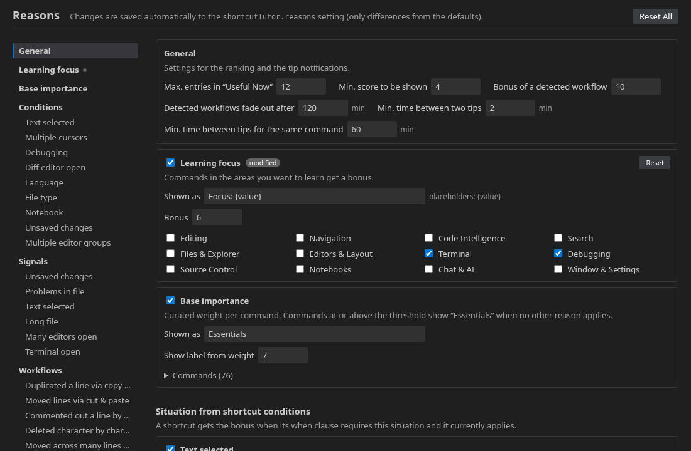

# Shortcut Tutor

Learn the keyboard shortcuts that matter **right now**. Shortcut Tutor watches what you are doing in VS Code, shows the shortcuts most worth learning in the current situation, and gives you a tip when you do something the slow way.

Open it from the **keyboard icon** in the Activity Bar, or run **Shortcut Tutor: Show Useful Shortcuts** from the Command Palette. `Ctrl+Alt+Shift+K` (macOS: `Cmd+Alt+Shift+K`) toggles the view.

> **Author's note:** My idea for an extension to learn shortcuts for VS Code – let's see if it helps …



## Features

### Useful Now

A short, ranked list (12 entries by default) of shortcuts that are useful at this moment. Each entry shows the command, its key combination(s) and **why** it is listed, for example:

- **Essentials**: core shortcuts everyone should know (Quick Open, Command Palette, Go to Definition, Rename, …)
- **The current situation**: text is selected, a debug session is running, a diff editor is open, the file has unsaved changes or problems, the file is long, many editors are open, the shortcut only applies to the current language, …
- **Your learning focus**: areas you chose to learn (see below)
- **Detected workflows**: something you just did by hand that a shortcut would do faster (see Tips)

The list updates as you work: when you select text, start debugging or switch files.

### Learning focus

Choose the areas you want to learn: Editing, Navigation, Code Intelligence, Search, Files & Explorer, Editors & Layout, Terminal, Debugging, Source Control, Notebooks, Chat & AI, Window & Settings. Shortcuts from these areas get a bonus and move up.

Click the line at the top of the view, the **target button** in the view's title bar, or run **Shortcut Tutor: Choose Learning Focus**.

Each chosen area also gets its own collapsible section above **Learned**, for example **Focus: Navigation (42)**. It lists every shortcut of the area, not only those that fit the current situation. Learned shortcuts are dimmed there.

### Boost

Click **☆** next to a shortcut in a focus section or in the search results to boost it. It turns into a yellow **★**, gets a bonus (8 by default) and moves up in “Useful Now” with the reason **Boosted**. It still only appears when it applies in the current situation. Click **★** again to remove the boost.

Boosted shortcuts are listed under the reason **Boosted by you** in **Edit Reasons**, where you can change their bonus or remove them.

### Search

The search field at the top of the view searches **all** shortcuts, regardless of the current situation, by name, command ID or key. Keys can be typed as VS Code stores them (`ctrl+k`) or as they are shown (`Ctrl+K`). With several words, all of them must match, e.g. `line ctrl`. `Esc` clears the search. At most 100 results are shown.

### Filter by shortcut

Click **⌨** next to the search field and press keys to find out what they do, just like “Record Keys” in the Keyboard Shortcuts editor:

- The list filters live while you hold keys: holding `Ctrl` lists all `Ctrl` shortcuts, adding `Shift` narrows them to `Ctrl+Shift`.
- Pressing a main key records the combination. Exact matches come first, followed by shortcuts that need more keys: additional modifiers (`Ctrl+K` also finds `Ctrl+Shift+K`) or a second chord (`Ctrl+K` also finds `Ctrl+K Ctrl+S`).
- A second combination narrows the list to that chord sequence.
- `Esc` clears the recorded keys, a second `Esc` ends recording. Clicking **⌨** again also ends it.

Letters and digits follow your keyboard layout, as in VS Code. Other keys are matched by their position on a US keyboard and by scan code (`[Equal]`).

### Tips

Shortcut Tutor notices common slow workflows and suggests the matching shortcut:

| You did … | Suggested |
| --- | --- |
| Duplicated a line via copy & paste | Copy Line Down |
| Moved lines via cut & paste | Move Line Down |
| Typed a comment marker in front of code by hand | Toggle Line Comment |
| Deleted many characters one by one | Delete Word Left |
| Pressed the up/down arrow many times in a row | Go to Line |
| Pressed the left/right arrow many times in a row | Cursor Word Right |
| Selected all text with the mouse | Select All |
| Selected whole lines with the mouse | Expand Line Selection |
| Placed multiple cursors with the mouse | Add Cursor Below |
| Opened many files in a short time | Quick Open |
| Switched back and forth between two files | Previous editor (Ctrl+Tab) |

The latest tip appears as a card at the top of the view, and optionally as a notification (at most every 2 minutes, once per hour per command). Turn notifications off with **No more tips** or the `shortcutTutor.notifications` setting.

### Got it

Hover an entry and click **✓** to mark the shortcut as learned. It disappears from “Useful Now” and from tips, so the next shortcut worth learning moves up. Learned shortcuts are listed under **Learned**, where **↺** brings them back. Your progress is synced across machines via Settings Sync.

### Change a shortcut

Hover an entry and click **✎** to open the Keyboard Shortcuts editor filtered to that command. Hovering the title shows the command ID and the `when` clauses of its bindings.

### Edit Reasons

The **gear button** in the view's title bar (or **Shortcut Tutor: Edit Reasons**) opens an editor with every reason, grouped and with a navigation on the left. For each reason you can:



- turn it on or off
- change the text shown in the view (placeholders such as `{value}` or `{count}` are supported)
- change its bonus, thresholds (e.g. number of key presses, time window, line count) and commands
- edit the base importance of every command

Changes are saved immediately. Only differences from the defaults are stored, in the `shortcutTutor.reasons` setting. **Reset** restores a single reason, **Reset All** restores everything.

## Settings

| Setting | Default | Description |
| --- | --- | --- |
| `shortcutTutor.notifications` | `true` | Show a notification when a slow workflow is detected. |
| `shortcutTutor.keyboardLayout` | `auto` | Keyboard layout for labeling keys that VS Code defines by physical position (see below). |
| `shortcutTutor.reasons` | `{}` | Your changes to the reasons. Easiest to edit via **Edit Reasons**. |

### Keyboard layout

VS Code defines a few default shortcuts by physical key position. In its default keybindings these appear as scan codes such as `[Equal]`. Extensions cannot read your keyboard layout, so Shortcut Tutor labels these keys for the layout set in `shortcutTutor.keyboardLayout`:

- `auto` guesses the layout from the system locale (`de_DE` → German, `de_CH` → Swiss German, `en_GB` → English UK, `fr_FR` → French, …, otherwise US)
- or choose one of: English (US), English (UK), German, Swiss German, French (AZERTY), Spanish, Italian, Swedish / Finnish

Example: `Ctrl+Shift+[Equal]` is shown as `Ctrl+Shift+´` on a German keyboard.

## Limitations

- **VS Code does not report which commands you run.** Shortcut Tutor cannot tell whether you already use a shortcut. Tips are based on what is observable: text changes, mouse vs. keyboard selection and editor switches. Mark shortcuts you know with **Got it**.
- **Focus is assumed to be in the editor.** VS Code does not reveal where keyboard focus is, so shortcuts for the terminal or lists are not boosted by focus.
- **Context keys from other extensions** cannot be read. Shortcuts that depend on them are never hidden, but they are not boosted either.
- **Filter by shortcut and punctuation keys:** since the keyboard layout cannot be read, punctuation keys are matched by their US position. On other layouts a recorded punctuation key may find the wrong shortcuts.
- **Areas are derived from command IDs.** Commands of extensions with their own namespace (e.g. `markdown.*`) belong to no area.
- **Settings profiles:** only the `keybindings.json` of the default profile is read.

## Development

```bash
npm install
npm run compile      # or: npm run watch
```

Press `F5` in VS Code to launch an Extension Development Host. Changes to `package.json` (icons, commands, settings) only take effect after restarting it.

To build and install a package:

```bash
npm run package
code --install-extension vscode-shortcut-tutor-0.1.2.vsix
```

## License

MIT © 2026 Janos Kovac – see [LICENSE](LICENSE).
